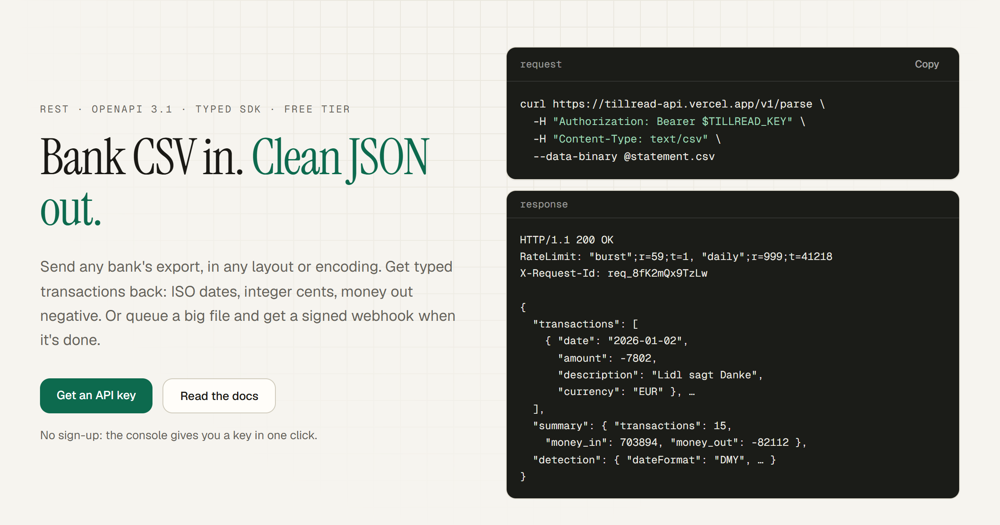
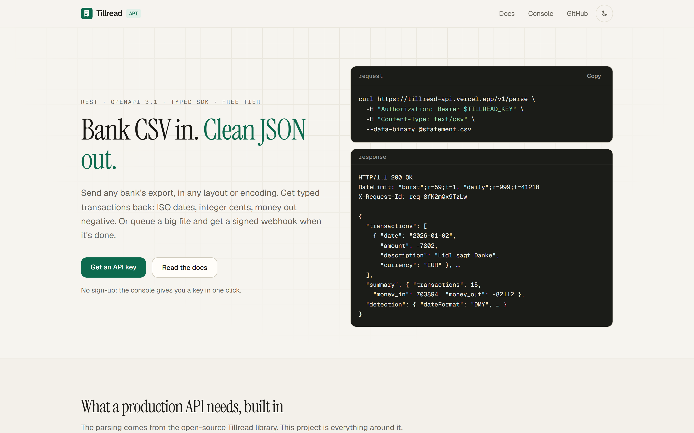
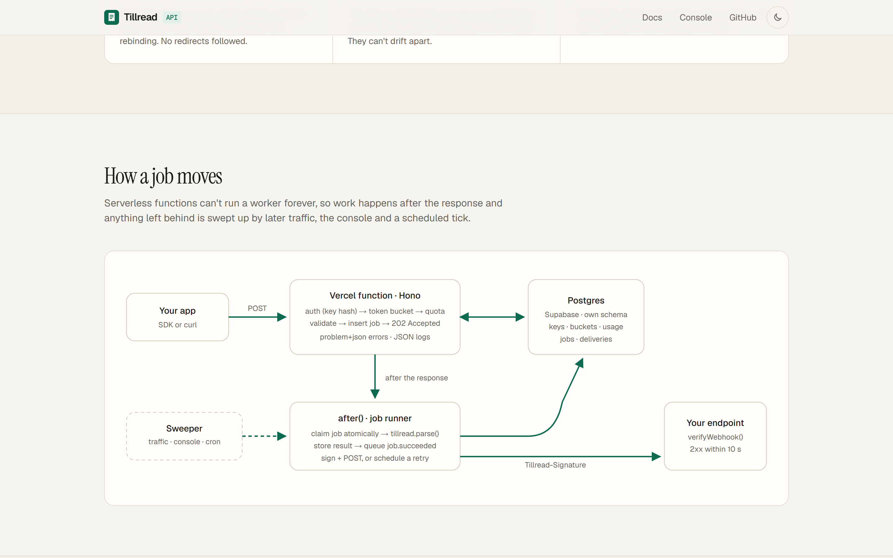
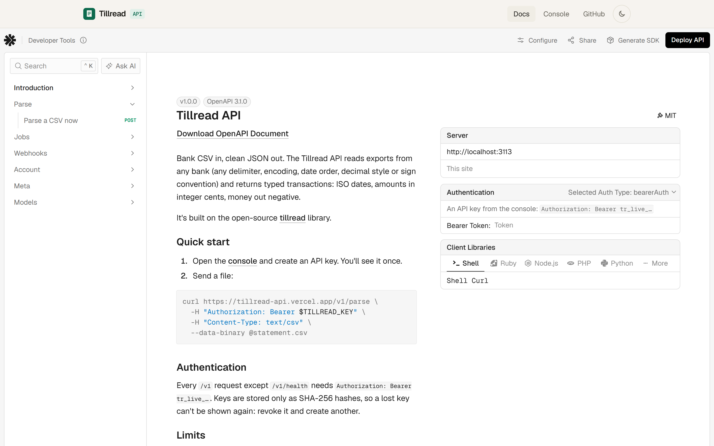
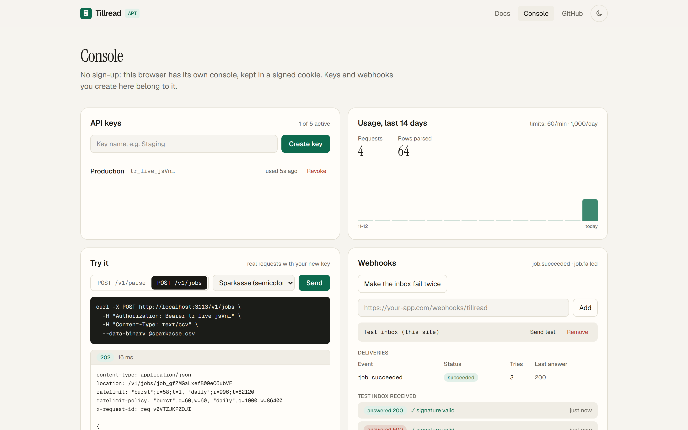
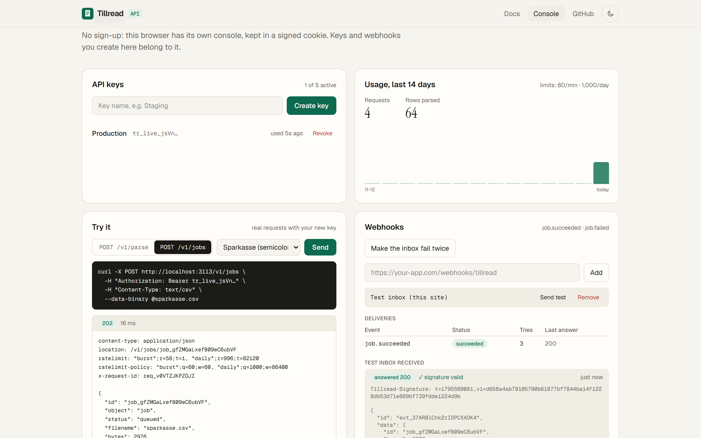
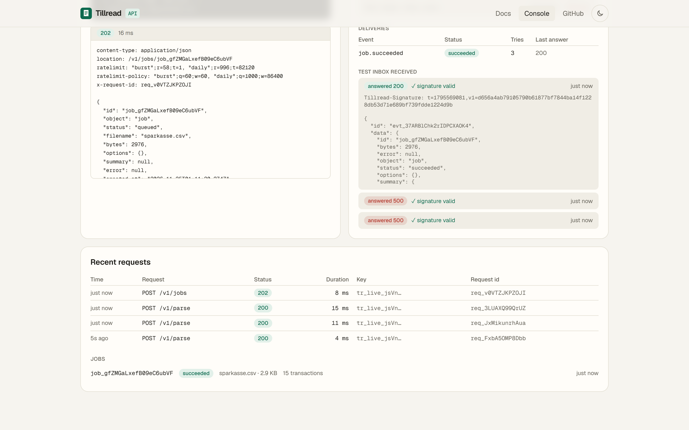
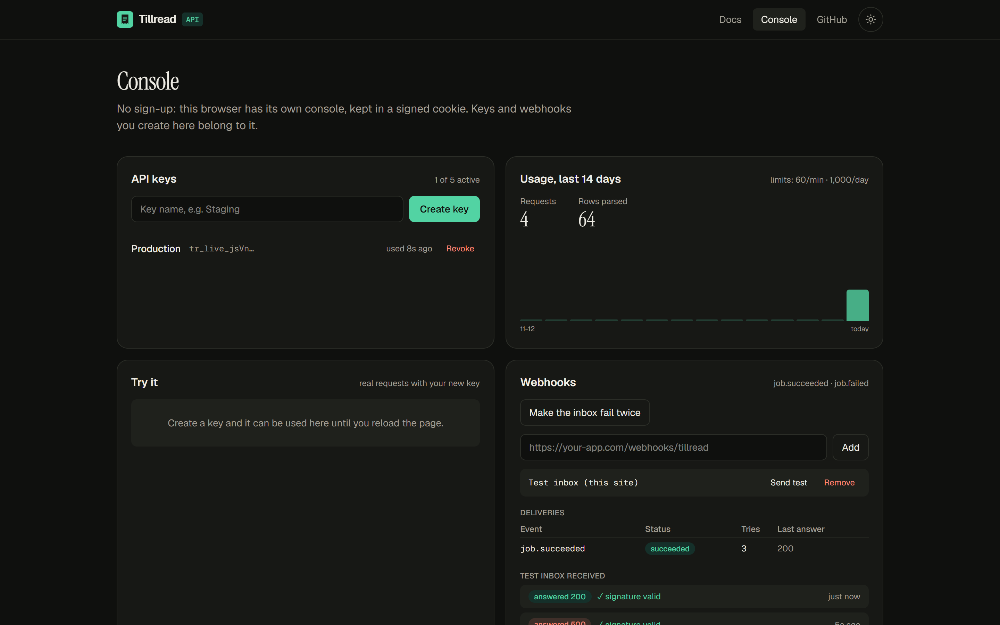
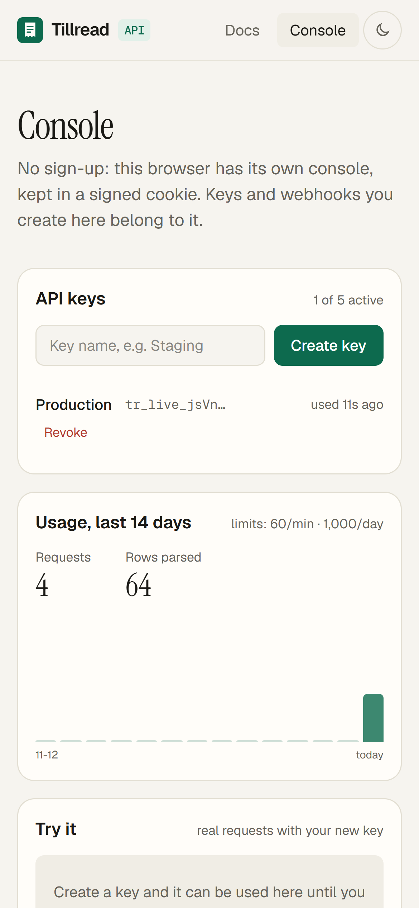

# Tillread API: bank CSV in, clean JSON out

**Live:** https://tillread-api.vercel.app · **Docs:** [/docs](https://tillread-api.vercel.app/docs) · **Console:** [/console](https://tillread-api.vercel.app/console) · **Spec:** [/openapi.json](https://tillread-api.vercel.app/openapi.json)

A public REST API that reads any bank's CSV export into typed transactions, built around my open-source [Tillread](https://github.com/shervs336/tillread) library. The parsing is the library's job; this project is everything a real API needs around it:
- API keys and rate limits
- usage metering
- async jobs with idempotency
- signed webhooks with retries and SSRF protection
- OpenAPI docs and a typed SDK
- a developer console



```bash
curl https://tillread-api.vercel.app/v1/parse \
  -H "Authorization: Bearer $TILLREAD_KEY" \
  -H "Content-Type: text/csv" \
  --data-binary @statement.csv
```

The case study is in [`docs/case-study.md`](docs/case-study.md).

## Screenshots

| Landing | How a job moves | API reference |
|---|---|---|
|  |  |  |

| Console | Try it + webhook retries | Requests and jobs | Dark | Phone |
|---|---|---|---|---|
|  |  |  |  |  |

## Endpoints

| | |
|---|---|
| `POST /v1/parse` | Parse a file (≤ 1 MB, any encoding, or JSON `{ csv, options }`) and get transactions now |
| `POST /v1/jobs` | Queue a file (≤ 4 MB); `Idempotency-Key` supported; `202` + `Location` |
| `GET /v1/jobs`, `/v1/jobs/{id}`, `/v1/jobs/{id}/result` | List (cursor pagination), status, result |
| `GET /v1/usage` | Requests, rows parsed and jobs per day for 30 days, plus limits |
| `GET/POST/DELETE /v1/webhook-endpoints` | Manage endpoints; the signing secret is returned once |
| `GET /v1/health` | No key; checks the database |
| `GET /openapi.json` | OpenAPI 3.1, generated from the route definitions |

## How it works

- **Keys:** `tr_live_` + 32 random base62 characters. Only the SHA-256 hash is stored; the console shows a key once.
- **Rate limit:** a token bucket per key (60 burst, 1/s refill), refilled, spent and recorded in **one atomic Postgres upsert**. Concurrent requests queue on the row lock, so the bucket can't be overdrawn.
  - A daily quota (1,000 requests, 100 jobs) is counted the same way.
  - Every response carries the IETF `RateLimit-Policy` / `RateLimit` headers, and a `429` has `Retry-After`.
- **Jobs on serverless:**
  - The job row is written, the API answers `202`, then Next's `after()` claims and runs the job.
  - The claim is a single conditional `UPDATE`, so a job picked up twice runs once.
  - A job whose function was killed mid-run is reclaimed after two minutes, by the next request's sweep, the console or the cron tick.
  - The uploaded file is deleted once it's parsed.
- **Idempotency:**
  - `(key, Idempotency-Key)` is unique. A retried request gets the original job back (`200`, `Idempotent-Replayed: true`).
  - The same key with a different body gets `422`.
  - A race between two identical requests is resolved by the unique index.
- **Webhooks:**
  - `Tillread-Signature: t=…,v1=HMAC-SHA256("t.body")`, with a timestamp tolerance against replays.
  - Deliveries are claimed atomically, sent with a 10 s timeout and no redirects, and retried after 30 s, 2 min, 10 min, 1 h and 6 h. Then they're marked failed and can be redelivered from the console.
- **SSRF protection:**
  - Webhook URLs must be HTTPS and resolve only to public addresses (IPv4 and IPv6 private, loopback, link-local and CGNAT ranges are blocked, including IPv4-mapped IPv6).
  - The check runs at creation and again before every delivery, against DNS rebinding.
- **Errors:** RFC 9457 problem documents (`application/problem+json`) with a stable `code` and the same `request_id` that appears in the `X-Request-Id` header and the JSON logs.
- **Console without accounts:**
  - An anonymous console is a signed, HttpOnly, SameSite=Lax cookie.
  - Changes also require an `X-Console` header and a same-origin `Origin` (CSRF).
  - New consoles are rate-limited per hashed IP.
  - A built-in **test inbox** receives your webhooks, checks their signatures and can be told to fail, so you can watch retries happen.
- **Database:**
  - Its own `tillread` schema with Row Level Security on and no policies, so the tables can share a Supabase project without being exposed through its REST API.
  - Locally and in tests, the same SQL runs in **PGlite** (Postgres in WebAssembly).

## Built with

Next.js 16 (route handlers + `after()`) · Hono + `@hono/zod-openapi` · Zod 4 · Postgres (Supabase) via postgres.js · PGlite for local dev and tests · Scalar API reference · openapi-typescript + openapi-fetch for the SDK · Vitest · autocannon · Tailwind CSS v4 · Vercel.

## Testing

- **29 integration tests** (`npm test`) on a real Postgres (PGlite), using a real HTTP server as the webhook receiver:
  - auth: missing, invalid and revoked keys; keys stored only as hashes
  - parse: raw bytes in other encodings, JSON bodies, options, and the 413, 415 and 422 errors
  - rate limits: the burst then `429` with headers, no overdraw under 12 concurrent requests, the daily quota and usage
  - jobs: run after the response, idempotent replay and key reuse, per-key isolation, cursor pagination, the job quota, and recovery of a job whose function died
  - webhooks: signatures checked by the SDK's verifier, the retry schedule then giving up, manual redelivery, SSRF rules (including DNS rebinding and IPv6) and stale or tampered signatures
  - console: CSRF guard, forged cookies, key limits, and the flaky test inbox
  - OpenAPI coverage and structured logs
- **The production driver:** one test runs the main flow through postgres.js over the Postgres wire protocol, served by PGlite's socket server.
  - It caught a real bug: postgres.js serializes JSON parameters itself, so pre-stringified values were stored as JSON strings.
- **The typed SDK** is tested against the real app, which proves the spec, client and server agree.
- **Browser tests, 16 of 16 passing:**
  - console: create a key, try parse and jobs
  - webhooks: a flaky inbox answering 500 → 500 → 200 with valid signatures
  - request log, usage, revoking a key
  - docs render, 360 px layouts, no console errors
- **Load test** (`npm run loadtest`, local production build with PGlite):
  - `GET /v1/health`: about 785 req/s, p99 53 ms
  - `POST /v1/parse` from 50 connections for 15 s with one key: 5,883 requests, of which exactly 74 were allowed (60 burst + 14 refilled), the rest answered `429` with p99 258 ms and 0 errors

## Lighthouse

| | Performance | Accessibility | Best Practices | SEO |
|---|---|---|---|---|
| Desktop (landing, console) | 100 | 100 | 100 | 100 |
| Mobile (landing, console) | 98–99 | 100 | 100 | 100 |

## Run it

```bash
npm install
npm run dev          # http://localhost:3000, in-memory Postgres (PGlite), no setup
npm test
npm run sdk          # regenerate openapi.json and the SDK types
npm run loadtest -- http://localhost:3000
```

### Deploy

1. Supabase → SQL editor: run [`db/schema.sql`](db/schema.sql).
2. Vercel: import the repo and set:
   - `DATABASE_URL`: Supabase → Connect → Transaction pooler, port 6543
   - `CRON_SECRET`: any long random string
3. Optional, for webhook retries every minute instead of only on traffic and the daily cron: Supabase → `pg_cron` + `pg_net`.
   ```sql
   select cron.schedule('tillread-tick', '* * * * *', $$
     select net.http_get('https://tillread-api.vercel.app/api/cron/tick',
       headers => jsonb_build_object('Authorization', 'Bearer <CRON_SECRET>'))
   $$);
   ```

## Project structure

```
src/server/      app (routes + middleware), keys (auth, token bucket), jobs, webhooks (sign, SSRF, retries),
                 console (anonymous sessions, test inbox), db (postgres.js | PGlite), schemas (Zod + OpenAPI)
src/app/         landing, /docs (Scalar), /console, route handlers for /v1, /api and /openapi.json
packages/api-client/   typed SDK generated from openapi.json + verifyWebhook()
db/schema.sql    the whole schema (also embedded for PGlite)
tests/           integration, SDK and postgres.js driver tests
scripts/         openapi, schema, loadtest
```

## What I learned

- **Serverless changes how background work is designed.** There's no worker loop, so every step is a claimable state in the database, and anything can pick up what a killed function left behind.
- **Put the critical logic in one statement.** Doing the token bucket as one upsert avoids a whole class of race conditions without locks in the app.
- **Webhooks are mostly security and failure handling.** Signing, replay windows, SSRF checks at delivery time, timeouts, no redirects and retries took more work than sending the POST.
- **Test the driver you deploy.** The in-process test database and the production driver disagreed about JSON parameters, and only a wire-protocol test showed it.

_Edit these in your own words before sharing._
