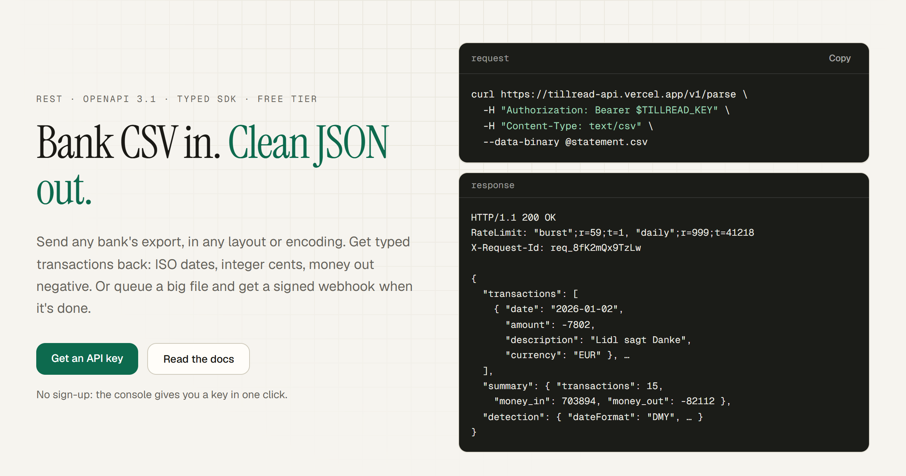
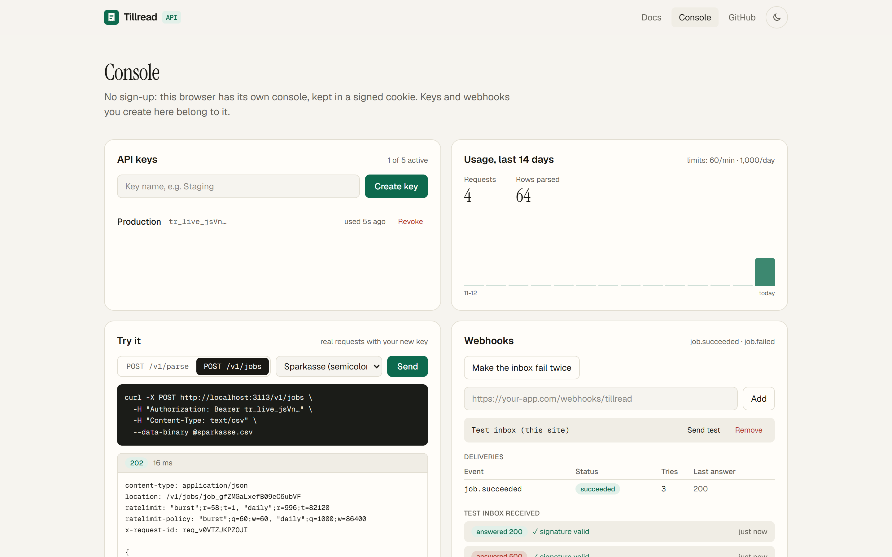
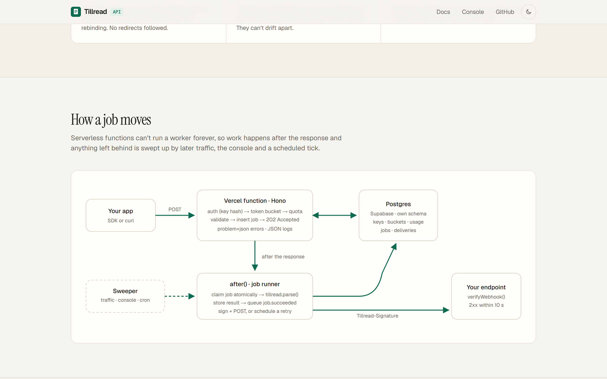
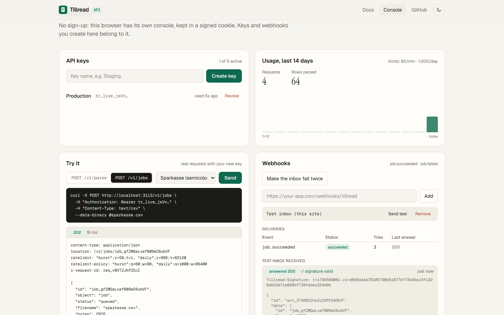
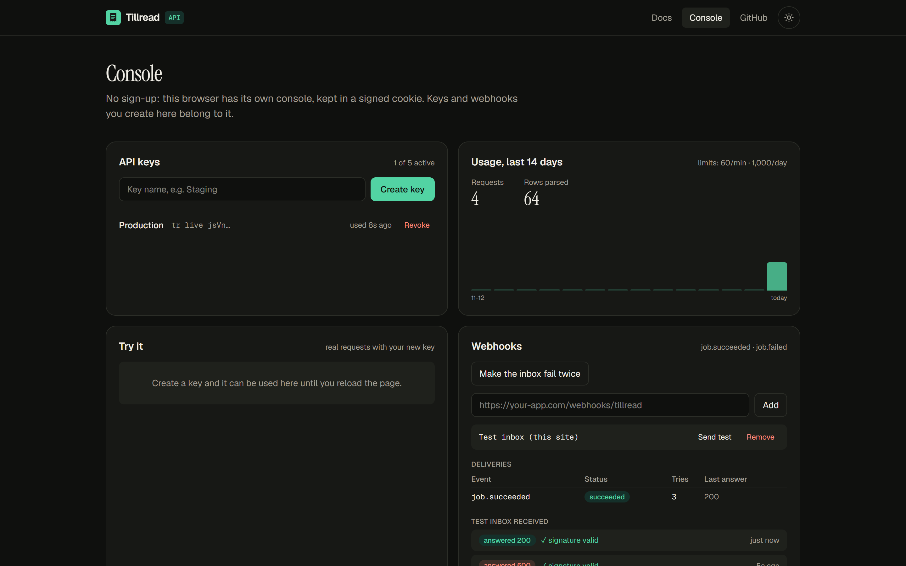
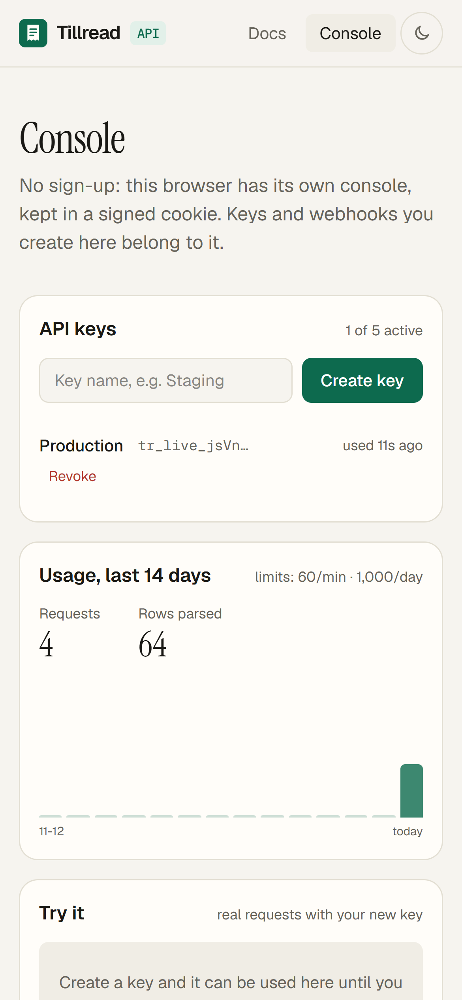

# Tillread API: case study

**Role:** Design and development (solo)
**Type:** Public REST API + developer console
**Stack:** Next.js 16, Hono, Zod + OpenAPI 3.1, Postgres (Supabase), postgres.js, PGlite, Scalar, openapi-typescript, Vitest, autocannon, Tailwind CSS v4, Vercel
**Links:** [Live](https://tillread-api.vercel.app) · [Docs](https://tillread-api.vercel.app/docs) · [Code](https://github.com/shervs336/tillread-api) · [The library](https://github.com/shervs336/tillread)

---

## Short version (for a portfolio card)

> A public API that turns any bank's CSV into clean JSON. It has the parts a production API needs: hashed API keys, an atomic token-bucket rate limiter, usage metering, async jobs with idempotency keys, signed webhooks with retries and SSRF protection, RFC 9457 errors, OpenAPI docs and a generated typed SDK. All of it runs on free tiers.

---

## Problem

My Tillread library parses bank CSVs well, but a library only helps teams writing JavaScript. A hosted API makes it usable from any language. It also raises the harder questions:
- Who's calling?
- How much can they call?
- What happens when a file is big, the network drops mid-request, or the customer's webhook server is down?

The goal was to answer those the way a real API provider would, on Vercel's and Supabase's free tiers, without a queue service or an always-on worker.

## Approach

- **Hono with Zod-OpenAPI route definitions.** Each route's schema validates the request and generates the OpenAPI document. The SDK's types are generated from that document, so docs, server and client can't drift.
- **Postgres as the coordination layer.** Rate-limit buckets, quotas, job claims and delivery claims are all single atomic statements, so many serverless instances can work at once without locks in the app.
- **Work after the response.** Jobs and webhook deliveries run in Next's `after()`. A sweeper re-runs anything that was left behind. It's triggered by ordinary traffic (at most once a minute per instance), by the console while something is pending, and by a scheduled tick.
- **A console that needs no account.** A signed cookie identifies an anonymous console, so anyone can get a key in one click. A built-in test inbox makes webhooks something you can see working, including failures and retries.

## Key decisions

| Decision | Why |
|---|---|
| Token bucket as one `INSERT … ON CONFLICT DO UPDATE` | Refill, spend and the allowed/denied flag happen under the row lock, so 12 concurrent requests against a burst of 5 let exactly 5 through. |
| Keys stored as SHA-256 hashes, shown once | A database leak doesn't leak working keys. |
| `202 Accepted` + `after()` + claimable states | Background jobs on serverless without a queue service. A killed function's job is reclaimed after two minutes. |
| `Idempotency-Key` backed by a unique index | Retries are safe, and two identical requests racing each other still produce one job. |
| Webhook signature over `timestamp.body` | Proves the sender and blocks replays outside a five-minute window. The SDK verifies with Web Crypto, so it runs on any runtime. |
| SSRF checks at creation **and** before every delivery, no redirects | Stops webhooks from being aimed at internal addresses, including through DNS rebinding or a redirect. |
| Own schema, RLS on, no policies | Shares the free Supabase project with my other apps without exposing these tables through its REST API. |
| PGlite for development and tests | The same SQL runs everywhere, and contributors need no Postgres install. |

## Challenges

- **The driver gap.** Tests ran on PGlite's in-process API, but production uses postgres.js. A test that drives the app through postgres.js over the Postgres wire protocol (PGlite's socket server) found that postgres.js serializes JSON parameters itself, so values I had already stringified were stored as JSON strings. The fix was to pass objects to both drivers, and the test now guards it.
- **Validation and raw bodies.** The OpenAPI validator tried to read CSV uploads as JSON. Request bodies are now validated by the route's own reader (which accepts raw bytes in any encoding as well as JSON), and the published spec still marks the body required.
- **Retries without a worker.** Vercel's free cron runs once a day. Retries are driven by ordinary traffic and the console instead. An optional Supabase `pg_cron` job can call the tick every minute for free.
- **Honest local testing.** Production refuses `http://` webhook URLs. The local production build needs an explicit flag to deliver to `localhost`, which the browser tests use. The deployed site's test inbox is HTTPS.

## Testing

- **29 integration tests** on real Postgres semantics, with a real HTTP webhook receiver:
  - auth, parsing, limits, quotas and concurrency
  - jobs: idempotency and recovery
  - webhooks: signatures, the retry schedule, redelivery and SSRF rules
  - console: security, the SDK and the production driver
- **16 browser tests** of the console: keys, real requests, a flaky inbox answering 500 → 500 → 200 with valid signatures, the request log, usage and revoking a key.
- **Load test:** under 50 concurrent connections for 15 seconds, one key got exactly 74 requests through (60 burst + 14 refilled). The other 5,809 were answered `429`, with p99 258 ms and no errors.

## Result

- A deployable API with documented endpoints, an interactive reference and a typed SDK, at $0 a month.
- Every production concern from the brief, with a test for each.
- **Lighthouse:** desktop 100 / 100 / 100 / 100; mobile 98–99 / 100 / 100 / 100.

| Dark mode | Phone |
|---|---|
|  |  |

## What I'd do next

- Accounts (magic-link sign-in) so keys survive a cleared browser, with consoles migrated on sign-in.
- Per-key IP allowlists and scoped keys (parse-only, read-only).
- A webhook event log with replay by time range.
